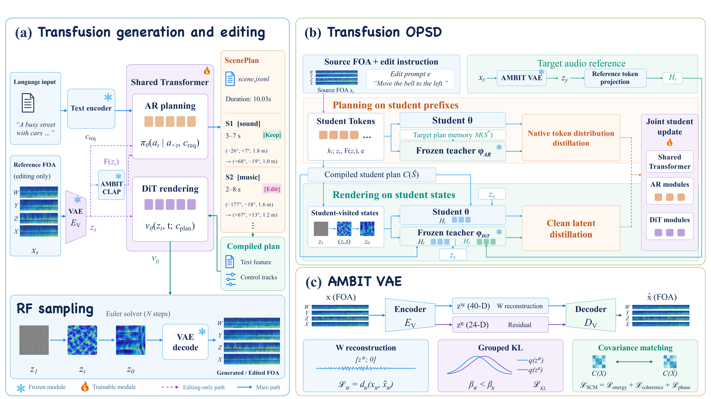

# AMBIT

[Overview](#overview) · [Installation](#installation) ·
[Generation](#spatial-audio-generation) · [Editing](#spatial-audio-editing)

[Listen to the interactive AMBIT demo](https://wjm-george.github.io/AMBIT/):
spatial audio generation and editing examples.

## Overview



Inference follows **text → AR → ScenePlan → DiT → FOA**.
Editing also conditions on the reference FOA audio.

## Installation

Requires Python 3.10+.

```bash
git clone https://github.com/WJM-George/AMBIT.git
cd AMBIT
python3 -m venv .venv
source .venv/bin/activate
python -m pip install -e .
```

## Pretrained models

**Coming soon.** The commands below require a local model bundle containing
the checkpoint, matching configuration, and tokenizer assets.
The inference implementation is included in this repository.

## Spatial audio generation

```bash
python -m ambit.infer generate \
  --bundle bundles/generation \
  --prompt "A dog barks to the left while a car passes from front to right." \
  --output outputs/generated.wav \
  --seed 42
```

## Spatial audio editing

```bash
python -m ambit.infer edit \
  --bundle bundles/editing \
  --source input_foa.wav \
  --prompt "Move the dog to the right while keeping the other sounds unchanged." \
  --output outputs/edited.wav \
  --seed 42
```

Audio uses **44.1 kHz, four-channel FOA in W, Y, Z, X order (ACN/SN3D)**.
Editing accepts a reference clip up to about 15 seconds. Both commands save
the audio and ScenePlan. Use `--help` for sampling and device options.

## Acknowledgements and license

AMBIT is developed on top of
[stable-audio-tools](https://github.com/Stability-AI/stable-audio-tools).

See [LICENSE](LICENSE) and [THIRD_PARTY_NOTICES.md](THIRD_PARTY_NOTICES.md).
