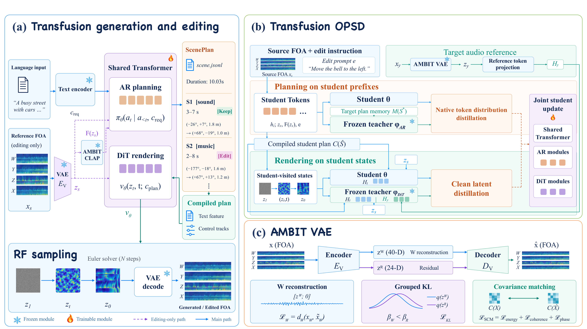

# AMBIT

**Spatial Audio Generation and Editing with Executable Plans and Self-Distilling Transfusion**

[](https://arxiv.org/abs/2610.34415)
[](https://wjm-george.github.io/AMBIT/)
[](https://huggingface.co/papers/2610.34415)
[](https://huggingface.co/WJM-George/AMBIT)

## Overview



Inference follows **text → AR → ScenePlan → DiT → FOA**.
Editing also conditions on the reference FOA audio.

## Installation

Requires Python 3.10+, Linux, and an NVIDIA CUDA GPU supporting bfloat16.

```bash
git clone https://github.com/WJM-George/AMBIT.git
cd AMBIT
python3 -m venv .venv
source .venv/bin/activate
python -m pip install -e .
```

## Model checkpoint

Download the [AMBIT model checkpoint](https://huggingface.co/WJM-George/AMBIT):

```bash
hf download WJM-George/AMBIT --local-dir models/AMBIT
```

One unified model supports both generation and editing. This release uses the
275k checkpoint, with a Qwen3.5-4B AR request encoder and an expanded ScenePlan
head. The DiT text encoder remains Qwen3.5-0.8B. AR and DiT share the same
Transformer backbone. All necessary model assets are included in the download.

## Spatial audio generation

```bash
python -m ambit.infer generate \
  --bundle models/AMBIT \
  --prompt "A dog barks to the left while a car passes from front to right." \
  --output outputs/generated.wav \
  --seed 42
```

## Spatial audio editing

```bash
python -m ambit.infer edit \
  --bundle models/AMBIT \
  --source input_foa.wav \
  --prompt "Move the dog to the right while keeping the other sounds unchanged." \
  --output outputs/edited.wav \
  --seed 42
```

The ScenePlan is generated by AR from the request; no supplied plan is required.
Generation defaults to 100 Euler steps with CFG 3; editing uses 20 steps with CFG 1.

Audio uses **44.1 kHz, four-channel FOA in W, Y, Z, X order (ACN/SN3D)**.
Editing accepts a reference clip up to about 15 seconds. Both commands save
the audio and ScenePlan. Use `--help` for sampling and device options.

## Acknowledgements and license

AMBIT is developed on top of
[stable-audio-tools](https://github.com/Stability-AI/stable-audio-tools).

See [LICENSE](LICENSE) and [THIRD_PARTY_NOTICES.md](THIRD_PARTY_NOTICES.md).

## Citation

```bibtex
@article{wu2026spatial,
  title={Spatial Audio Generation and Editing with Executable Plans and Self-Distilling Transfusion},
  author={Wu, Kam Man and Zhang, Yu and Fang, Pengjun and Chen, Mingfei and Chen, Weijia and Tian, Zeyue and Chen, Qifeng},
  journal={arXiv preprint arXiv:2610.34415},
  year={2026}
}
```
